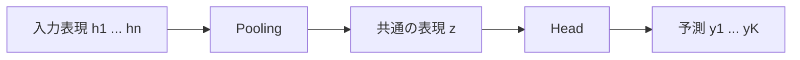
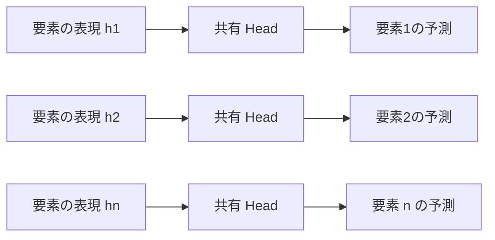
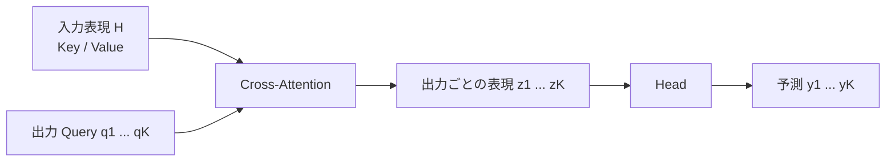
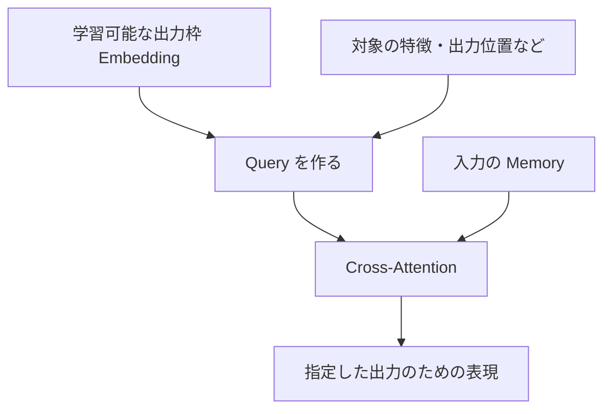
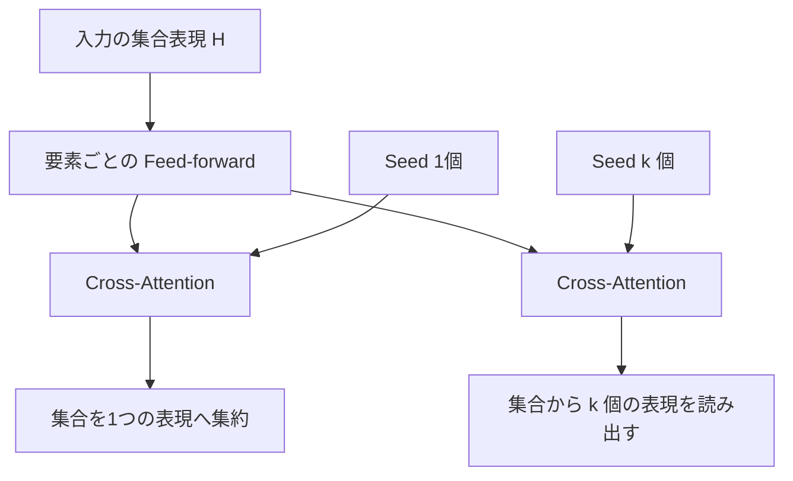
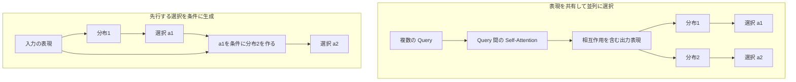

## はじめに

[前々回の記事](https://qiita.com/atsushi11o7/items/8133c3113878dca33491)では、複数のサブアクションを並列に生成するか、先行する選択を条件に逐次生成するかという、出力間の依存関係を扱いました。[前回の記事](https://qiita.com/atsushi11o7/items/25d521a800c5364876a7)では、可変個のエンティティを含む入力を、集約特徴や entity token としてどう表現するかを扱いました。

今回は、この2つの間にある話です。入力をエンコードして複数の表現が得られたとして、そこから予測をどう作ればいいか考えます。

例えば、複数のセンサーから設備全体の異常を判定する場合と、画像内の各物体について属性を分類する場合では、欲しい出力の単位が違います。画像の特徴から物体検出の候補を生成する場合は、入力の特徴と出力候補が一対一で対応するとも限りません。

この記事では、集合や複数の token として表現された入力から予測を作る方法を、pooling・要素ごとの予測・出力 query という3つの構成で考えます。モデル全般を網羅する分類ではなく、入力の表現と出力をどう接続するかに範囲を絞って整理します。

## 入力の単位と出力の単位

まず、入力をどう分割して表現するかと、何に対して予測するかを分けて考えます。

| 欲しい出力 | 例 | 入力との対応 |
|---|---|---|
| 全体への予測 | 複数センサーから設備全体の異常を判定する | 入力全体に対する1つの予測 |
| 各要素への予測 | 各物体の属性を分類する | 入力要素と出力が対応する |
| 別に用意した枠への予測 | 画像特徴から複数の物体候補を生成する | 入力 token と出力枠は直接対応しない |

同じ入力でも、複数の出力形式が考えられます。物体の集合から、シーン全体のカテゴリと、各物体の属性を同時に予測することもできます。

入力 token の数が、そのまま出力数を決める必要はありません。どの単位で情報を保持するかと、どの単位で情報を読み出すかは、別々に設計できます。

## 予測を作る3つの構成

入力をエンコードした表現を $H=(h_ 1,\ldots,h_ n)$ とします。ここから予測を作る構成を3つ並べます。以下の式は情報の流れを示す簡略形です。

### Pooling でまとめてから予測する

$$
z=\mathrm{Pool}(H),\qquad (y_ 1,\ldots,y_ K)=g(z)
$$

mean や sum などで入力全体を1つの表現にまとめ、head で予測します。設備全体の異常判定のような、全体への予測で自然な構成です。

1つのベクトルから出す予測は、1個とは限りません。設備全体の温度・消費電力・故障確率をまとめて予測するなど、固定数の出力を持たせることもできます。

この場合、出力ごとの違いは head の重みなどで表現します。読み出しの段階では、すべての出力が共通の表現 $z$ を受け取ります。

### 各要素の表現から予測する

$$
y_ i=g(h_ i)
$$

入力要素ごとの表現に head を適用します。各物体の属性分類や、各単語のラベル予測など、入力と出力に自然な対応がある場合の構成です。同じ種類の要素には head を共有できます。

入力要素が増えても、同じ head を追加の要素へ適用できます。入力の一部だけが予測対象なら、その要素の表現だけを取り出すこともできます。

ここで、$h_ i$ は要素 $i$ 自身の情報しか持たないとは限りません。encoder に self-attention があれば、他の要素の情報も取り込めます。「各要素から予測する」ことと、「各要素を孤立して判断する」ことは別です。

### 出力 query で読み出してから予測する

$$
z_ i=\mathrm{Attention}(q_ i,H,H),\qquad y_ i=g(z_ i)
$$

出力ごとに query を用意し、入力表現を key/value として cross-attention します。入力 token から直接予測する代わりに、出力のための表現 $z_ i$ を作る構成です。

入力の分割方法とは別に、出力枠を設計できます。例えば、画像の patch 表現から物体候補を出す場合、patch 数と候補数を一致させる必要はありません。

query は、学習可能な固定ベクトルだけでなく、出力位置や対象の特徴から作ることもできます。何を query に持たせるかで、読み出しの意味が変わります。

## 3つの構成は何が違うのか

中心となる違いは、出力に必要な情報をどこで集めるかです。

| 構成 | 出力の足場になる表現 | 出力ごとの情報を集める場所 |
|---|---|---|
| Pooling + head | 入力全体を集約した共通表現 | Encoder と、集約後の head |
| 要素ごとの head | 対応する入力要素の表現 | 主に Encoder |
| 出力 query + head | Query が作る出力側の表現 | Encoder に加え、出力側の cross-attention |

要素ごとの head でも、encoder が十分な情報を各要素に集めていれば、全体の状況に基づく予測ができます。query 方式だけが広い文脈を使えるわけではありません。

また、出力が1個でも違いは残ります。mean pooling は各要素を等しく集約しますが、query による attention pooling は、入力に応じて重みを変えます。

方式を選ぶ際は、入力に予測対象の表現がすでにあるか、全体をまとめた表現で十分か、出力ごとに情報を読み出す段階を設けたいかを考えます。query を追加すれば必ず高性能になるという関係ではなく、学習のしやすさや計算量も含めた比較が必要です。

## 入力と出力の対応をどう持たせるか

各要素の表現から予測する場合、出力と入力の対応は添字で表せます。要素 $i$ の表現から出した予測を、要素 $i$ に返せばよいからです。

別の query を用意した場合は、この対応も設計する必要があります。例えば、学習可能な固定ベクトル $s_ i$ は「第$i$出力枠」を区別できますが、それだけで特定の対象に結びつくわけではありません。

対象が決まっているなら、次のように特徴を与える方法があります。

$$
q_ i=s_ i+\mathrm{Embed}(\text{対象の位置}_ i)+\mathrm{Embed}(\text{対象の特徴}_ i)
$$

また、対象のエンコード表現 $h_ i$ を query として使うこともできます。この場合、「要素ごとの予測」に、別の表現を参照する処理を加えた構成と捉えられます。

一方、物体検出のように、予測対象が事前には分からない場合もあります。[DETR (Carion et al., 2020)](https://www.ecva.net/papers/eccv_2020/papers_ECCV/papers/123460205.pdf)では、学習可能な object query から候補を生成し、学習時に予測と正解を二部マッチングで一対一に対応づけます。特定の query が常に同じ物体を担当するという前提ではありません。

[Perceiver IO (Jaegle et al., 2021)](https://arxiv.org/abs/2107.14795)では、出力位置やタスクなどを表す query を使い、潜在表現から必要な出力を読み出します。

query を「何のための情報を集めたいかを指定する表現」と考えると、対象の特徴、出力位置、学習可能な出力枠という選択肢を整理できます。

### 並び替えたときの振る舞い

前回扱った置換不変性・置換等変性も、読み出しの設計に関係します。入力の行を並び替える行列を $P$ とすると、全体への予測では、

$$
f(PX)=f(X)
$$

という置換不変性が欲しくなります。各要素への予測を入力順に返すなら、

$$
f(PX)=P f(X)
$$

という置換等変性が欲しくなります。

置換等変な encoder の後に、mean や sum を置けば不変な表現を作れます。各要素に共有 head を適用すれば、要素ごとの予測も等変になります。これは[Deep Sets (Zaheer et al., 2017)](https://arxiv.org/abs/1703.06114)や[Set Transformer (Lee et al., 2019)](https://proceedings.mlr.press/v97/lee19d.html)につながる考え方です。

cross-attention では、query を固定し、key/value を同じように並び替えた場合、

$$
\mathrm{Attention}(Q,PH,PH)=\mathrm{Attention}(Q,H,H)
$$

となります。入力の格納順が変わっても、同じ query には同じ情報を返します。ただし、encoder の出力も置換に追従し、mask も対応して並び替えることが前提です。格納順に固定された位置情報などがあれば、モデル全体の性質は別途確認が必要です。

対象の特徴から query を作り、その query も対象と一緒に並び替えるなら、出力も対応して並び替わります。query を使うかどうかだけで、不変性・等変性が決まるわけではありません。

## Attention pooling と出力 query をつなぐ PMA

[Set Transformer (Lee et al., 2019)](https://proceedings.mlr.press/v97/lee19d.html)の Pooling by Multihead Attention（PMA）は、学習可能な seed ベクトルを使って集合から表現を読み出します。

原論文では、$k$個の seed $S$ を使い、次のように定義されます。

$$
\mathrm{PMA}_ k(H)=\mathrm{MAB}(S,\mathrm{rFF}(H))
$$

rFF は要素ごとの feed-forward network、MAB は multi-head attention に残差接続、LayerNorm、feed-forward network を組み合わせたブロックです。その中心には、seed を query とする cross-attention があります。

seed が1個なら、1個の query で集合を集約する attention pooling です。複数なら、複数の出力側表現を作ります。この意味で、attention pooling と複数 query による読み出しは地続きです。

ただし、mean や max などの pooling 全般が、seed 数だけで query 方式と同じになるわけではありません。また、複数 seed を用意しただけで、それぞれが異なる対象を担当する保証もありません。

Set Transformer では、複数出力の関係を扱うため、PMA の後に self-attention を置く構成も使われています。出力のための表現同士をどう関係づけるかは、pooling や query の選択とは別の論点です。

## 出力表現の情報交換と、生成結果への条件付け

複数の出力 query を用意した場合、その間に self-attention を置けば、各 query は他の query の表現を参照できます。DETR の decoder も、query 間の self-attention と、入力 memory への cross-attention を複数層で適用します。

ただし、これは自己回帰生成と同じではありません。

query 間で情報交換しても、その後に各出力を別々の categorical 分布から独立にサンプルするなら、入力 $X$ が与えられた下での同時分布は、

$$
p(a_ 1,\ldots,a_ K\mid X)=\prod_ i p_ i(a_ i\mid X)
$$

と分解されます。他の query の表現を参照することと、他の出力が実際に選んだ値を条件にすることは違います。ここでは query の処理は決定論的で、共有の確率的潜在変数などは使わない構成を考えています。

一方、自己回帰では、

$$
p(a_ 1,\ldots,a_ K\mid X)=\prod_ i p_ i(a_ i\mid X,a_ {<i})
$$

と、先行する選択を条件に次の分布を作ります。

前々回の記事で扱った並列方策と自己回帰方策の違いは、この部分です。今回扱った「どの表現から予測するか」とは別の設計軸になります。例えば、cross-attention による読み出しを、並列出力にも自己回帰 decoder にも使えます。

## 比較の出発点をどう置くか

実際に設計するなら、まず出力の意味を確認します。

- 全体の性質を予測するなら、pooling + head を試す。
- 入力の各要素に予測を返すなら、各要素の表現 + 共有 head を試す。
- 入力 token と異なる単位で出力を作るなら、出力 query による読み出しを検討する。

これは方式を一意に決める規則ではなく、比較の出発点です。固定数の出力なら、pooling した表現からまとめて生成する案もあります。対象表現を query にして、追加の情報を読み出す案もあります。

query 方式では、query の内容と数、cross-attention の層数、query 間の self-attention を使うかを設計します。入力が $n$ 個、query が $K$ 個なら、通常の cross-attention の attention 部分は $O(Kn)$、query 間の self-attention 部分は $O(K^2)$ です。これは埋め込み次元を固定した場合の要素数に対するオーダーで、共有 encoder などの計算は別にかかります。

比較実験では、同じ入力情報と学習条件を使い、予測性能、学習の安定性、推論時間、メモリ使用量を確認します。出力 query を追加する効果と、単に層数やパラメータが増える効果も、可能な範囲で切り分けるなどが考えられます。

## まとめ

入力の表現と、予測を返す単位は一致するとは限りません。全体を集約する、各要素の表現を使う、出力 query で読み出すという構成は、出力に必要な情報をどこで集めるかという違いとして捉えられます。

query を使う場合は、その query が何を指定するのかも設計の一部です。対象の特徴、出力位置、学習可能な出力枠などを通して、入力との対応を持たせます。PMA は、こうした query による読み出しと attention pooling をつなぐ例です。

そして、出力の表現同士で情報交換することと、選択済みの出力を条件に次を生成することは別です。入力の表現、出力のための読み出し、生成時の依存関係を分けて考えると、それぞれの構成が何を担っているのか整理できます。
