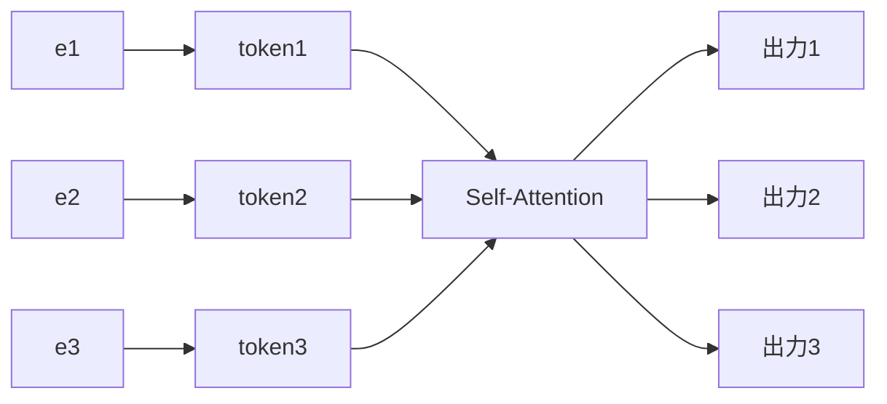
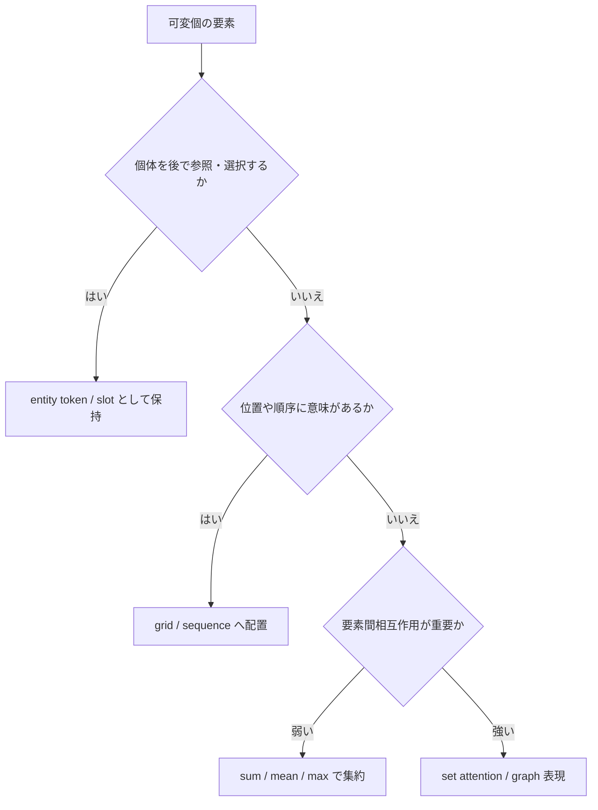
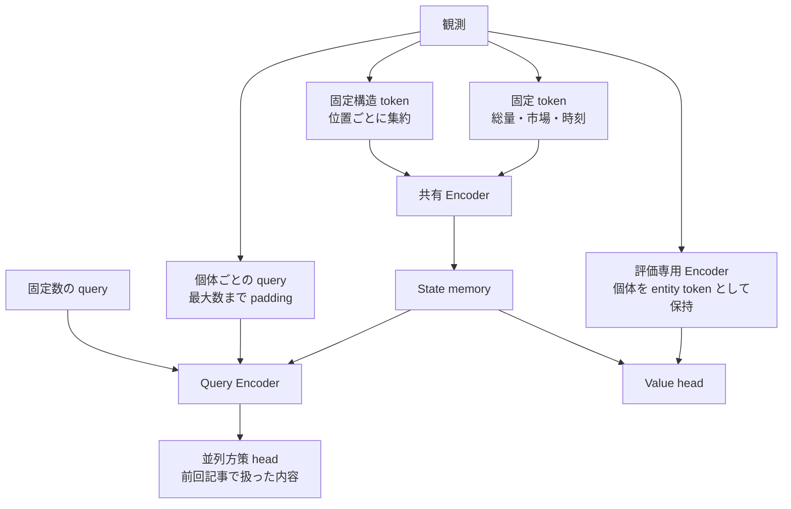

## はじめに

前回の記事では、方策が1回の意思決定で複数のサブアクションを出力する「行動の分解」について書きました。

https://qiita.com/atsushi11o7/items/8133c3113878dca33491

今回はそれに関連する話として、ネットワークに渡す観測そのものをどう組み立てるかを扱います。

同じ農業シミュレーションコンペ「Kaggriculture」で、雇用状況によって数が変わるユニットなど、要素数がステップごとに変動するエンティティを観測に含める必要がありました。

https://www.kaggle.com/competitions/kaggriculture

この記事では、そうした可変個数のエンティティを、固定構造・集約特徴・entity token・query など、どの表現が適しているか整理します。

本文では、複数のエージェントとその処理対象が存在するシミュレータを例に使います。同じ構造は、ロボットや自動運転、マルチエージェント環境などにも当てはまります。

## 問題設定

ネットワークへ渡す観測を、次の2つに分けて考えます。

$$
o = \big(o_ {\text{fixed}},\ E\big),\qquad E=\{e_ 1,e_ 2,\ldots,e_ n\}
$$

$o_ {\text{fixed}}$は要素数が常に決まっている部分です。一方、$E$はステップごとに要素数$n$が変わるエンティティの集合です。この記事が扱うのは$E$側です。

$E$について、次の性質が一定でないことを整理しておきます。

- 要素数($n$がステップごとに変わる)
- 順序(意味を持つ場合と持たない場合がある)
- 種類(同じ集合に複数の型が混在する場合がある)
- 個体識別の必要性(後で「どの要素か」を参照する必要があるか)
- 要素間の相互作用の強さ

## 表現方法の選択肢

可変個のエンティティに対する代表的な表現方法を、適する情報・失われる情報とともに整理します。

| 表現方法 | 適する情報 | 失われるもの |
|---|---|---|
| 固定構造へ配置(grid/sequence) | 既知の位置・時系列・固定スロット | 構造外の要素を扱いにくい |
| sum/mean/max 集約 | 集合全体の要約が必要な場合 | 個体のアドレス指定、集約後の個別情報 |
| entity token(self-attention 等) | 個体ごとの状態や相互作用を個別の表現へ明示的に反映したい場合 | 計算量が要素数の2乗に増える |
| query/slot | 個体を選択・操作する必要がある場合 | 最大数や対応関係の設計が必要 |
| 潜在表現への圧縮(bottleneck) | 要素数が非常に多い、または詳細度を抑えたい群 | 細かな個体情報が失われうる |

「要素数が可変」という事実だけでは、表現方法は決まりません。位置に構造があるなら固定構造へ、個体を後から指し示す必要がなければ集約で十分なことが多く、個体ごとに行動を返す必要がある場合だけ query や entity token が必要になります。以降の章で各方式を詳しく見ていきます。

## 固定長化すれば解決するのか

まず、表の「固定構造へ配置」にある、最大要素数$N_ {\max}$を固定して$E$を1本のベクトルへ flatten する方法を検討します。

問題になるのは、flatten 後のベクトルを全結合層へ入力した場合に、その入力次元と最初の層のパラメータ数が$N_ {\max}$に比例して増えることです。また、最大数への padding 自体が問題というわけではありません。entity token 方式でも padding は使います。

本当の問題は、flatten して「何番目の位置か」に固有の意味を学習させてしまうことです。要素の並び順を入力特徴量の位置に固定すると、本来は順序に意味がないはずの要素に、暗黙の順序依存が入り込みます。同じ種類の要素でも、たまたま何番目に出現したかによって扱われ方が変わってしまいます。

要素数が可変で、順序に意味がない場合がある集合を扱うには、単純な flatten とは別の原理が必要です。

## entity token の設計

個体ごとの状態や相互作用が重要な場合に使う、entity token 化の構成要素を見ていきます。

各エンティティは、特徴量を共通次元$d$へ投影する埋め込み関数$\phi$で token 化します。種類が複数ある場合は、型ごとの埋め込み関数$\phi_ {\text{type}}$を用意し、型を表す type embedding を加算して共通空間へ混ぜます。

$$
\text{token}_ e = \phi_ {\text{type}(e)}(e) + \text{embed}_ {\text{type}}(\text{type}(e))
$$

必要であれば、個体を識別するための ID 情報も加えます(位置 encoding との関係は次章で扱います)。

エンティティが複数の離散フィールド$x_ 1,\ldots,x_ k$を持つ場合(種類、状態、数量帯など)、1つの token へまとめる方法にも選択肢があります。フィールドごとに埋め込みを求め、結合する方式と、

$$
h=\operatorname{concat}\big(E_ 1(x_ 1),\ldots,E_ k(x_ k)\big)
$$

和を取る方式です。

$$
h=\sum_ {r=1}^{k}E_ r(x_ r)
$$

和をとる方式は、フィールド数が増えても token 幅が変わらず、各フィールドの語彙と意味を分離したまま、埋め込み後すぐ共通の Transformer へ渡せます。一方で、各フィールドを明示的に分離した表現は失われます。concat は情報源を保持しやすい代わりに、入力幅と後段のパラメータがフィールド数に応じて増えます。どちらも、異種フィールドから1つの token を作る一般的な選択肢です。

実装上は要素数$n$が可変でも、バッチ化・JIT コンパイル・GPU 上でのベクトル化のために、最大数$N_ {\max}$まで padding し、有効/無効を表す mask を別に持つ設計がよく使われます。mask の実装では、次のような素朴な加算式を使うと問題が起きます。

$$
\text{score}_ {ij}' = \text{score}_ {ij} + (1-\text{mask}_ j)\cdot(-\infty)
$$

浮動小数点演算では、有効な位置($\text{mask}_ j=1$)で$0\times(-\infty)$という計算が発生し、NaN を生む可能性があります。次のような区分的な定義にするか、実装では NumPy や JAX、PyTorch などが提供する `where` 関数を使うことで解決できます。

$$
b_ j=\begin{cases}0 & \text{if }m_ j=1\\-\infty & \text{if }m_ j=0\end{cases},\qquad\text{score}_ {ij}'=\text{score}_ {ij}+b_ j
$$

```python
masked_score = where(mask, score, large_negative)
```

また、padding 位置の出力自体は計算されてしまうため、attention 内で mask しても安全とは限りません。後続の集約・loss 計算・出力でも、改めて mask を適用します。要素数が0の場合(エンティティが1つも存在しない場合)も、個別に対応します。

明示的な mask の代わりに、存在しない要素へ範囲外の sentinel 値(位置 ID など)を与え、その意味をモデルに学習させる方式もあります。ただしこれは mask と同等に安全な代替ではありません。モデルが無視することを学習するだけで、無視が保証されるわけではなく、sentinel を持つ要素も attention 計算には参加し続けます。出力や loss の計算では、別途明示的な mask が必要になることも多くあります。両者は排他的ではなく、入力側では sentinel で「存在しない」という意味を表しつつ、loss・出力側では明示的な mask を併用する、という設計もできます。

## Transformer で集合を扱う条件

self-attention は、各要素の表現を残したまま、要素間の相互作用を取り込める置換等変な演算です。

$$
\text{output}_ i = \sum_ {j=1}^{n} \mathrm{softmax}_ j\!\left(\frac{q_ i\cdot k_ j}{\sqrt{d}}\right) v_ j
$$

置換行列$P$を使うと、置換等変性は次のように表せます。

$$
\operatorname{Attn}(PX)=P\operatorname{Attn}(X)
$$

ただし、この性質が成り立つには条件があります。全要素に同じ変換(同じ$W_ Q,W_ K,W_ V$)を適用すること、そして mask も要素の並びと同じ置換に合わせて並べ替えることです。位置情報については、何が壊すかを区別します。配列上の slot 番号(格納順)に固定された位置 embedding を加えると、格納順そのものに意味が生まれてしまい、置換等変性は失われます。一方、物体の座標やグラフ上の位置のように、各 entity に付随する位置特徴を他の特徴と同じように entity へ持たせ、entity と一緒に並べ替える場合は、置換等変性を保てます。壊すのは「位置」そのものではなく、「格納順に固定された」位置情報です。

entity に付随する位置特徴そのものをどう表現するかにも、いくつかの選択肢があります。entity へ絶対座標を特徴として持たせる方法、attention スコアへ相対変位$(\Delta x,\Delta y)$の bias を加える方法、2次元 axial RoPE のように回転によって相対的な座標差を埋め込む方法です。いずれも、同じ相対的な位置関係を盤面上のどこでも同じように扱えることを狙った設計ですが、attention スコアが$(\Delta x,\Delta y)$だけで決まるわけではなく、entity の内容にも依存します。

これに対して、集合全体を1つの表現に潰す置換不変な集約もあります。Deep Sets (Zaheer et al., 2017) は、一定の条件下で、置換不変な関数を sum による集約を含む形で表現できることを示しました。

$$
f(E) = \rho\left(\sum_ {e\in E}\phi(e)\right)
$$

ここで注意したいのは、sum・mean・max がいずれも置換不変であっても、保持する情報は同一ではないという点です。mean では要素数の情報が失われ、max では最大値以外の分布の情報が大きく失われます。また、Deep Sets の表現定理は sum について一定の条件下で成立する話であり、mean や max へそのまま置き換えられるわけではありません。



pooling は集合全体を1つの表現に潰す置換不変な演算、self-attention は要素数を保つ置換等変な演算です。入力 entity と同じ添字で要素ごとの表現を得たい場合は、置換等変な処理が適しています。一方、観測表現とは別に query を用意し、cross-attention によって個別の出力を生成する設計もあります。query は必ずしも entity token を self-attention した出力そのものではありません。

計算量を抑えたい場合は、Set Transformer (Lee et al., 2019) のように、少数の inducing points を介して attention を計算する構成もあります。Perceiver や Set Transformer は、少数の latent や inducing points を介して入力を処理する構成を示したものであり、本来は大規模な入力や集合を効率的に処理するための仕組みです。

## 計算量とのトレードオフ

self-attention の計算量は、要素数$n$に対して$O(n^2)$です。エンティティ数が大きくなる問題では、この計算量が無視できなくなります。

対処の方向性としては、グループ化してから集約する階層的な pooling、Set Transformer の inducing points による$O(nm)$への削減、エンティティ間の関係をグラフとして疎に定義する GNN 的なアプローチがあります。

集約表現と entity token 表現は、排他的ではありません。同じ観測の中で、大部分は集約し、個体識別が必要な一部だけ entity token にする、という併用も可能です。「可変個の要素がある」という事実だけで、観測全体を entity token に統一する必要はありません。

## 表現を選ぶための判断基準

ここまでの選択肢を、問題設定の章で挙げた軸に基づいて整理します。



最初の分岐点は「個体を後で参照・選択する必要があるか」です。行動を個別に返す必要があるなら entity token や query として保持し、そうでなければ位置構造への集約や、sum/mean/max による集約で十分な場合が多くあります。sum/mean/max による集約も$\phi$と$\rho$を通じて集合全体に依存する関数を表現できるため、相互作用を一切表現できないわけではありません。ただし、要素間の関係を個体ごとの表現へ明示的に反映したい場合は、attention やグラフ表現が有力になります。

この判断は、観測全体に対して1回だけ行うのではなく、エンティティ群ごとに行ってよいです。1つの観測の中に、固定構造へ集約する情報と、個体ごとに保持する情報が混在していても構いません。

## 採用した設計

農業コンペで採用した設計を、前章の判断基準に沿って簡潔に紹介します。詳細なゲーム仕様や実験結果には踏み込みません。

盤面の各位置は固定構造(grid)として扱い、その位置にいるユニットの情報は個体としてではなく、位置ごとの集約特徴(そのタイルにいるユニット数など)として埋め込みました。在庫や所持品のように総量だけが重要な情報は、sum による集約特徴として1つの token にまとめています。これらはすべて固定本数の token として、共有の Encoder へ渡されます。

一方、行動を個別に返す必要があるユニットは、固定数まで padding した query として保持し、観測を集約した表現へ cross-attention する構成にしました。市場への注文も、観測側の可変なエンティティとしてではなく、固定数の行動 query として生成しています。実際にこのプロジェクトで可変なのはユニット query の mask だけで、観測 Encoder 自体は固定本数の token で構成されています。



もう1つ、方策には推論時に実際に利用できる公開観測だけを与える一方、学習時にのみ使う価値関数には、完全な状態に由来する追加情報(相手の非公開情報も含む)を与えています。この評価専用の Encoder では、個体ごとの情報を落とさず、padding・mask した entity token として保持しています。同じ「ユニットの情報」でも、行動を生成する経路では集約+query、価値を評価する経路では entity token、と参照の必要性によって扱いを変えています。

行動を生成する query へ cross-attention する設計は、観測のエンコードと行動の生成の境界にある話です。前回記事で扱った行動の分解・Executor の話ともつながりますが、本記事ではここで深入りしません。

## まとめ

要素数が可変であることと、要素を entity token として個別に保持することは同じではありません。固定構造・集約・entity token・query という複数の選択肢があり、個体を後で参照する必要があるか、位置や順序に構造があるか、要素間の相互作用がどれだけ重要かによって選びます。entity token を使う場合は、padding mask の実装(NaN 回避)や、置換等変性が成立する条件(位置 encoding の扱い)も関わってきます。

この記事はあくまで私が調べた範囲に基づく理解であり、誤りや異なる見解がある可能性を記しておきます。
